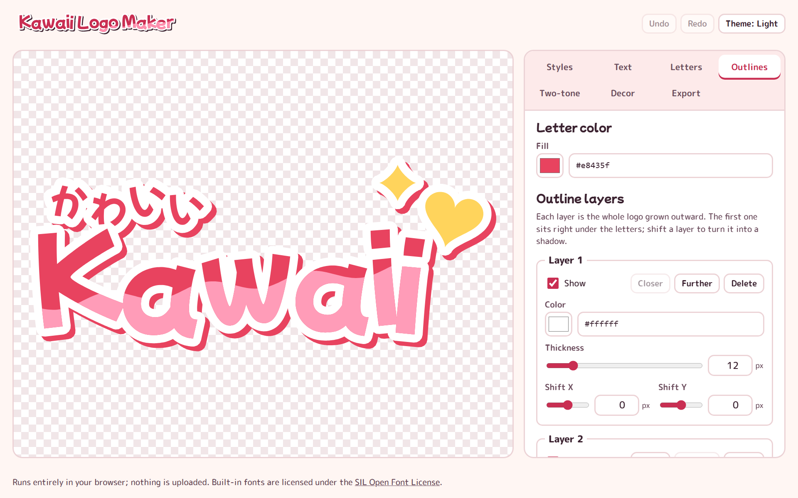
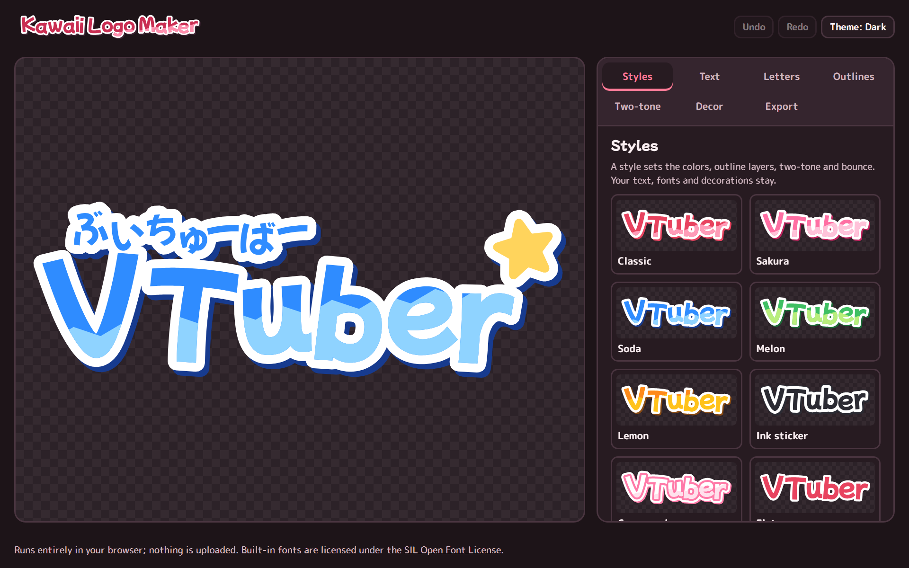

# Kawaii Logo Maker

A browser-based editor for kawaii, VTuber-style text logos: bubbly lettering with bouncing letters, stacked outlines, an offset shadow and a two-tone fill. Everything runs on the client; text, fonts and designs never leave your browser.





## Features

- **Styles**: eight ready-made looks, previewed with your own text, applied with one click. Save your own styles to reuse them on other logos.
- **Lettering**: each character becomes its own vector shape. A seeded "bounce" adds subtle tilt, lift and size variation, with an up-and-down or random pattern and a shuffle button.
- **Per-letter editing**: drag any letter on the canvas, rotate it with the handle, or nudge it with the keyboard. Shift+drag moves a whole line.
- **Multiple lines**: a main line plus any number of extra lines (for example a small Japanese reading above the name), each with its own font, size and spacing.
- **Outline layers**: any number of layers, each grown outward from the whole logo with its own color, thickness and offset. The default stack is a white outline plus a shifted shadow.
- **Two-tone fill**: color part of the letters with a wave, zigzag or straight cut, or draw your own shape on the canvas.
- **Decorations**: hearts, stars, sparkles, dots and flowers that merge into the outlines.
- **Image tracing**: drop a PNG, JPG, WebP or SVG to turn it into vector shapes that join the logo, either as a one-color silhouette or with its colors kept (up to 8). Threshold, detail, smoothness and speck removal are adjustable with a live preview.
- **Export**: SVG with every outline converted to real shapes (it opens identically in Figma or Illustrator), PNG at 1×, 2× or 4× with a transparent background, or SVG code copied to the clipboard.
- **Projects**: designs autosave in the browser and can be saved to or opened from a `.kawaii.json` file. Undo and redo cover every change.
- **Share links**: the whole design is compressed into the link, so sharing needs no server. Opening a link loads the design for editing, and undo brings back what you had before.
- Light and dark themes, keyboard support and a phone-friendly layout.

## Fonts

The bundled fonts are licensed under the SIL Open Font License 1.1 and can be used in logos freely:

| Font | Notes |
| --- | --- |
| Mochiy Pop P One (default) | Bubbly rounded display face, Latin and Japanese |
| Mochiy Pop One | Same design with monospaced Latin |
| M PLUS Rounded 1c ExtraBold | Rounded gothic |
| Zen Maru Gothic Black | Heavy rounded gothic |
| Hachi Maru Pop | Handwritten style |
| Kiwi Maru Medium | Rounded mincho |
| Dela Gothic One | Chunky display gothic |

License texts are in `public/fonts/`.

### Using your own font

Commercial fonts such as FOT-Yuruka Std can't be redistributed, so they aren't bundled. If you have a license, load the `.ttf`, `.otf` or `.woff` file with **Use my own font file** in the Text tab, or drop it anywhere on the page. The file is parsed locally and kept in the browser's IndexedDB for later visits. It is never uploaded. WOFF2 isn't supported yet.

Characters that a font doesn't have fall back to Mochiy Pop P One.

## Image tracing

Open **Decor → Trace an image**, or drop an image anywhere on the page.

- **One color** keeps the pixels that are more opaque (transparent images) or darker (opaque images) than the threshold, and paints the result in one color. **Invert** keeps the other part.
- **Keep colors** reduces the image to a few flat colors and traces each one. On opaque images the color along the border is treated as background and removed.
- **Detail** sets the resolution the image is traced at. **Smoothness** turns pixel steps into smooth curves; 0 keeps hard pixel edges. **Ignore specks** drops tiny shapes and holes.

Traced artwork behaves like any other decoration: it can be moved, rotated, resized, recolored and gets the logo's outline layers. Tracing runs in a background worker inside your browser; images are never uploaded.

Only trace artwork you have the right to use. Trademarked logos stay subject to their owners' brand guidelines.

## Sharing

**Export → Copy share link** packs the design into the part of the URL after `#`, which browsers never send to a server. Custom fonts are not part of the link; people who open it without the font see the default font until they add theirs. Links with traced artwork can get long, and some chat apps shorten or cut them, so a project file is the safer way to send those.

Designs from links and project files are validated before they are loaded.

## Keyboard

| Key | Action |
| --- | --- |
| Tab | Move between letters and decorations on the canvas |
| Arrow keys | Move the selected item by 1 px (Shift: 10 px) |
| `[` / `]` | Rotate by 3° (Shift: 15°) |
| `-` / `+` | Shrink or grow |
| `0` | Reset the selected letter |
| Delete | Remove the selected decoration |
| Esc | Clear the selection |
| Ctrl+Z / Ctrl+Y | Undo and redo |

## Development

Requires Node.js 20.19 or newer.

```bash
npm install
npm run dev
```

```bash
npm run build
```

The production build in `dist/` is a static site and can be served from any static host.

### How it works

Glyph outlines come from [opentype.js](https://github.com/opentypejs/opentype.js) and are flattened to polygons. [Clipper](https://www.npmjs.com/package/clipper-lib) unions the letters and decorations into one silhouette, grows it with round joins for each outline layer, and intersects the fill with the two-tone region. Images are traced by following pixel edges in a thresholded or color-reduced bitmap, then smoothed and simplified into polygons. The editor preview and the exported SVG are drawn from the same polygons, so the export matches the preview.

## Font licenses

Bundled fonts: SIL Open Font License 1.1, © their respective authors.
